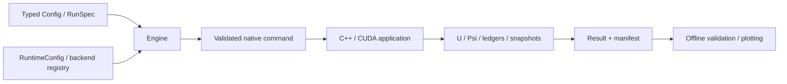

# Architecture

[English](architecture.md) | [日本語](ja/architecture.md) | [Index](index.md)

Python owns configuration, explicit builds, launch, provenance, and result
loading. Native C++ owns MPI/CUDA lifetimes, state, RK stages, retry, and saving.
State arrays do not travel through Python at every step.

## Python layer

| Module under `src/pyhmd/` | Responsibility |
| --- | --- |
| `config.py` | Typed settings, presets, INI conversion, unknown-field rejection |
| `spec.py` | A shared RunSpec for JSON, INI, and Python |
| `engine.py` | Plans, output ownership, native launch, terminal-state mapping |
| `runtime/` | Backend/MPI policy, rank count, launcher, binary, restart |
| `backends/` | Four implemented build targets, explicit compilation, fingerprints |
| `results/` | Atomic manifests, lazy artifact references, legacy result loading |
| `diagnostics/` | Numerical integrity, transport checks, snapshot-based paper diagnostics |
| `plotting/` | Figures, animation, and VTK from saved output |

The registry contains CPU, CPU+MPI, CUDA, and CUDA+MPI, without placeholder
models or solvers. `Config` describes the mathematical problem, `RuntimeConfig`
describes execution, and `ResultOptions` describes recording. Output intervals
clip time steps, so recording settings can affect the numerical trajectory and
are included in provenance.

## Native layer

Sources live in `src/pyhmd/native/` so wheels can carry them. The checkout's
`include/` aliases the bundled include directory.

| Under `native/include/pyhmd/` | Responsibility |
| --- | --- |
| `core/types.hpp` | State, parameter POD, mesh view |
| `config/native.hpp` | INI/argument parsing and cross-option restrictions |
| `physics/` | MHD fluxes and resistivity/current closures |
| `geometry/` | Cell/face measures, CT field access, mesh construction |
| `numerics/` | Reconstruction, FV/CT RHS, thermal recovery, CFL |
| `boundaries/` | Physical ghosts, flux-function boundaries, CUDA prefix scan |
| `distributed/` | MPI lifetime and rank/GPU mapping |
| `backend/` | Host/device buffers and parallel loops |
| `problems/` | Built-in initial states, disk equilibrium, initialization |
| `runtime/` | State/workspace ownership, RK/retry, application, validation protocol |
| `io/` | Checkpoints, diagnostics, snapshot output |
| `diagnostics/` | Accepted RK face-flux and CT contribution ledgers |

Legacy `include/pymhd/*.hpp` files forward to real definitions; they do not
duplicate them. `Solver` retains buffer and RK/retry ownership while numerical
functions live in their respective modules. CUDA POD layout, checkpoint layout,
and internal `PYMHD_*` macros are retained. Native global symbols are not a stable
external C++ API.

## Protocol and extension boundaries

`--describe` returns compiled capabilities without initializing MPI or a GPU.
`--validate-config` uses the execution parser and its restrictions. The Engine
rejects backend/model/scheme/dtype mismatches and does not build missing binaries.

An explicitly requested model extension needs a schema, preset, native closure,
and tests of its applicable regime. A backend needs a real build target,
registry entry, and capability checks. Verify structural and numerical changes
separately; moving code does not resolve boundary-angle or thermal-recovery gaps.
