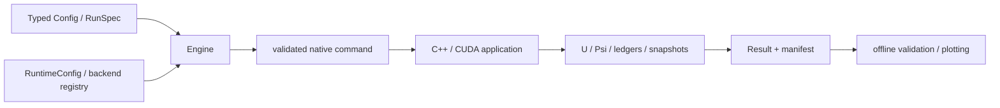

[English](../architecture.md) | [日本語](architecture.md) | [ドキュメント一覧](index.md)

# 設計

Pythonは設定、明示的ビルド、起動、provenance、結果の読込を担当します。
C++がMPIとCUDAのlifetimes、state、各RK段、retry、保存を所有します。
Pythonから各stepの配列を往復させる設計にはしていません。

## Python

| Module | 責務 |
| --- | --- |
| `config.py` | 現行設定の型・preset・INI変換、未知キーの拒否 |
| `spec.py` | JSON/INIから同じRunSpecを生成 |
| `engine.py` | plan、出力先の所有、native起動、終了状態の対応付け |
| `runtime/` | MPIの有無、rank、launcher、既存binary、restart |
| `backends/` | 実装済み4ビルドのregistry、明示的ビルドとsource指紋 |
| `results/` | atomic manifest、lazy artifact参照、旧形式の読込 |
| `diagnostics/` | 数値整合性・輸送検証・論文用snapshot推定 |
| `plotting/` | 保存結果だけを使う図・動画・VTK |

backendはCPU、CPU+MPI、CUDA、CUDA+MPIのみです。
model/schemeを増やすための空のpluginや未実装optionは追加していません。
Configは問題の数学、RuntimeConfigは実行環境、ResultOptionsは保存方針を表します。
出力間隔はdtを切り詰めるため数値軌道にも影響します。保存方針も必ずprovenanceに残します。

## Native層

ソースはwheelにも含めるため`src/pyhmd/native/`に配置しています。
`include/`はその公開includeルートへのcheckout内aliasです。

| `include/pyhmd/` | 責務 |
| --- | --- |
| `core/types.hpp` | state、parameter POD、mesh view |
| `config/native.hpp` | 既存INI/引数のparserと組合せ制約 |
| `physics/` | MHD flux、抵抗率・電流のclosure |
| `geometry/` | cell/face geometry、CT field access、mesh生成 |
| `numerics/` | reconstruction、FV/CT RHS、熱回復、CFL |
| `boundaries/` | physical ghosts、磁束関数境界、CUDA prefix scan |
| `distributed/` | MPI lifetimeとrank/GPUの対応 |
| `backend/` | host/device bufferとparallel loop |
| `problems/` | builtin初期条件、円盤平衡、initialization |
| `runtime/` | state/workspace所有、RK/retry、application、検証protocol |
| `io/` | checkpoint、診断/snapshot出力 |
| `diagnostics/` | accepted RK面流束とCT寄与の保存 |

旧`include/pymhd/*.hpp`は互換includeです。旧テストの参照先を保つ一方、実定義を二重に持ちません。
元の`Solver`はbuffersとRK/retryの所有者として残し、数値関数を各責務のheaderへ移しました。
CUDAで渡すPODや既存checkpointのlayout、`PYMHD_*`内部macroは維持しています。
native内部global symbolは現時点で安定した外部C++ APIとはしません。

## 検証プロトコルと拡張範囲

`--describe`はGPU/MPIを初期化せずcompiled capabilitiesを返します。
`--validate-config`は同じnative parserとcross-option検査を使います。
Engineはbackend/dtype/modelの不一致を拒否し、見つからないbinaryを自動ビルドしません。
新しいモデルの追加時はConfig schema・preset・native closure・適用範囲のテストを同時に追加します。
新しいbackendはregistry・build・capability検査を実装し、暗黙の代替実行はしません。

数値式の修正と構造整理を分けて検証します。この整理で境界角や熱回復の科学的な未検証事項が解決したとは扱いません。
